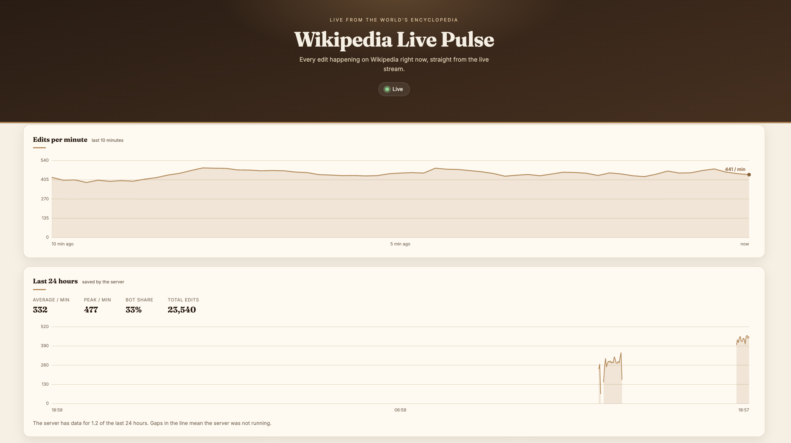
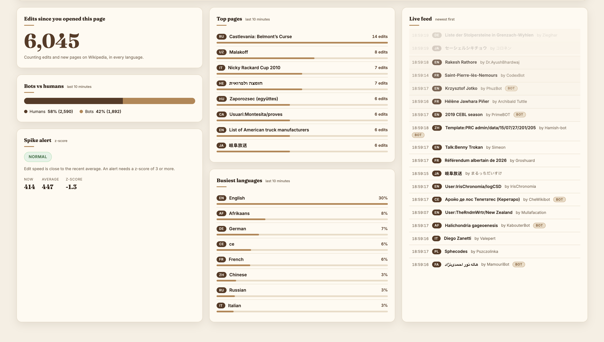

# Wikipedia Live Pulse

A real-time dashboard of every edit happening on Wikipedia right now, in every language. It reads Wikimedia's public live stream, calculates statistics as the edits arrive, and keeps 24 hours of history in a small backend.

**Live demo:** coming soon





## What it shows

- **Edits per minute:** a live line chart of the last 10 minutes, drawn by hand on a `<canvas>`
- **Last 24 hours:** saved history from the backend, with honest gaps where the server was not running
- **Top pages:** the most edited pages in a rolling 10-minute window
- **Busiest languages:** edit share per language, with readable names (`de` becomes German)
- **Bots vs humans:** the share of edits made by bots
- **Spike alert:** a z-score against a rolling baseline that flags sudden jumps in edit speed
- **Live feed:** the newest edits, with links to the pages

## How it works

```
Wikimedia stream (Server-Sent Events)
        |
        |-----> Browser (HTML, CSS, JavaScript)
        |         rolling windows, charts, spike detection
        |
        '-----> FastAPI backend --> SQLite (one row per minute)
                      |
                      '-- /stats?hours=24 --> Browser (history chart)
```

- The browser connects to the stream with `EventSource` and does all live analytics itself.
- The backend listens to the same stream all day, even when no page is open. It counts edits in memory and saves them to SQLite every 10 seconds, one row per minute.
- `GET /stats?hours=N` returns one point per minute. Minutes with no data are returned as 0, and the dashboard draws them as gaps, not as drops to zero.

## Technical decisions

- **No frameworks and no chart library.** Plain HTML, CSS and JavaScript, with charts drawn on a canvas.
- **Spike detection.** The newest point is compared with the older points using `z = (now - mean) / std`. A minimum standard deviation and a 3-minute warm-up stop false alarms in calm or new data.
- **Rolling windows.** Old edits are dropped as new ones arrive, so memory use stays flat.
- **Reconnects.** The browser reconnects by itself. The backend waits 5 seconds and retries.
- **Small database.** Saving one row per minute is about 1,440 rows a day, and upserts add to the existing minute.
- **Input limits.** `hours` must be between 1 and 168, and anything else gets a 422 error.
- **Safe rendering.** Text from Wikipedia is added with `textContent`, never as HTML.

## Run it locally

You need Python 3.12 and a browser.

**1. Start the backend**

```
cd backend
pip install fastapi "uvicorn[standard]" httpx
uvicorn main:app --reload
```

The API is then at `http://127.0.0.1:8000` (docs at `/docs`).

**2. Open the dashboard**

Open `index.html` in your browser. Without the backend, the live parts still work and the 24-hour card shows a friendly message.

## Tests

15 automatic tests.

```
# Backend (7 tests): minute counting, saving, gap filling, summary, input limits
cd backend
pip install pytest
python -m pytest -v

# Spike detection (8 tests): needs Node.js 18 or newer
node --test spike.test.js
```

The backend tests use a temporary database and a fake clock, so they never touch real data.

## Project structure

```
index.html        page structure
style.css         layout and theme
script.js         stream, rolling windows, charts, history
spike.js          spike detection (separate so Node can test it)
spike.test.js     tests for spike detection
backend/
  main.py         FastAPI app, stream listener, SQLite
  test_main.py    backend tests
```

## Data source

[Wikimedia EventStreams](https://stream.wikimedia.org/v2/stream/recentchange), a free public stream that needs no API key.

## License

Not chosen yet.